# Galaxy Notes · 思维奇点

**思维奇点（Galaxy Notes）** 是一个 Windows 本地笔记应用，它把笔记放进一片三维星系里。

每篇笔记是一颗星球。颜色你来挑，表面的斑块由笔记 ID 算出来——同一篇笔记，在哪台机器上、隔多久打开，长得都一样。左键点进去是全屏编辑器；点一下空白或按 `Esc`，星球缩回原来的位置，大小和视角都没变。

笔记之间的关系不写在正文里，而是画在星系上：`Ctrl` 选中两颗星球，右键建一条关联，给它起个标签（比如「同一问题的两面」），它们之间就长出一条发光的曲线。关联没有方向——只表达「有关」还是「无关」。

可以同时管多个星系（一个星系就是一个文件夹），左侧切换，每个星系各自记住你的视角；按标题搜索笔记；笔记里能贴图。

没有账号、没有云、没有同步冲突。数据就是硬盘上的一堆 JSON：一篇笔记一个文件，图片放在旁边的 `assets/`，关联单独存一份。断网照常用，备份就是拷文件夹。


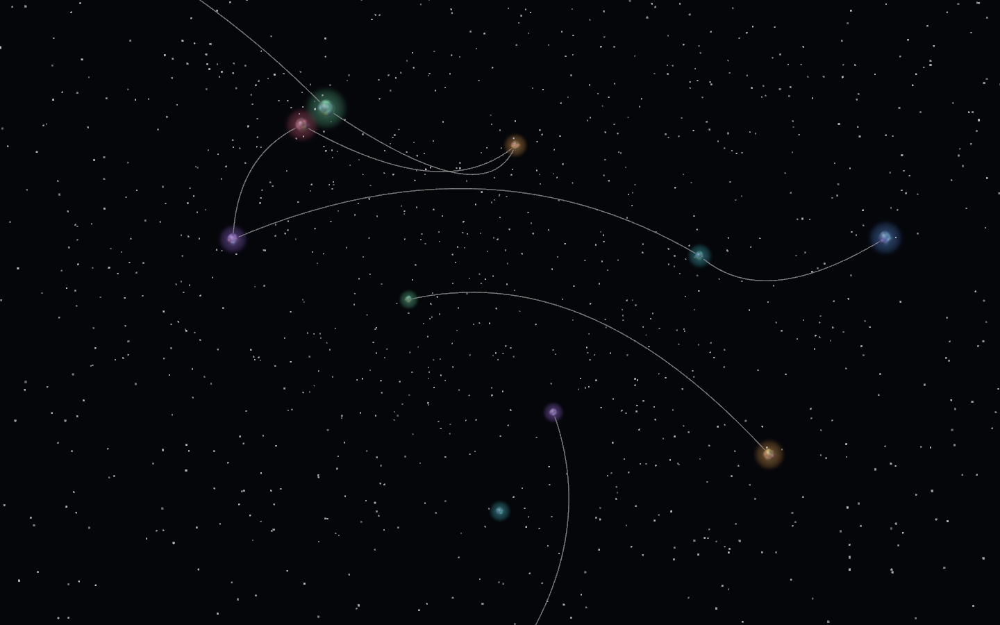

| 首次启动 | 点进星球编辑 | 建立关联 |
|---|---|---|
|  | 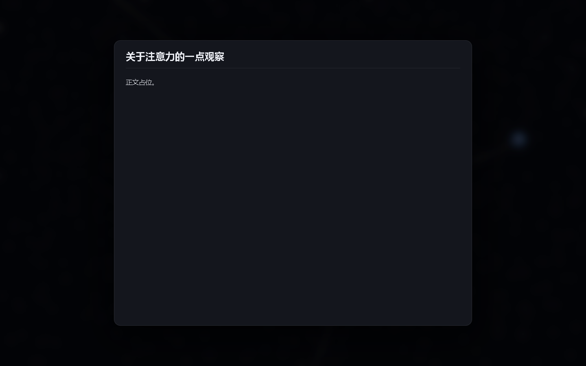 | 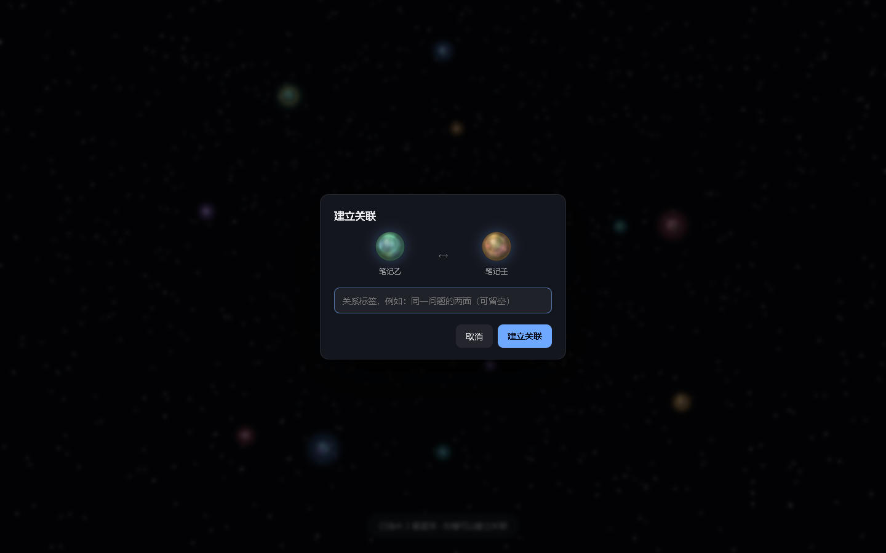 |

左侧是星系列表（多库）：一个星系 = 一个文件夹，可在多个星系之间切换。

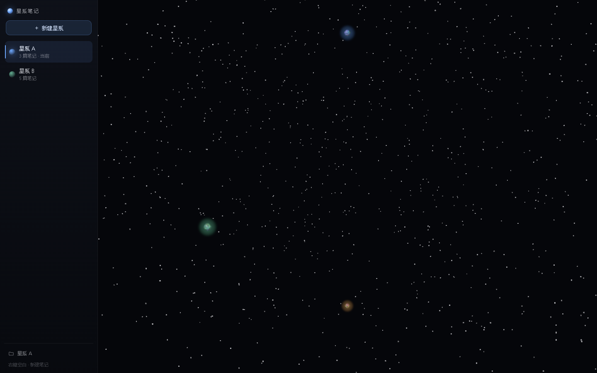

> **状态**：数据层、星系渲染、编辑、关联、多星系、搜索、图片已完成。
> **未实现**：AI 关联建议、移动端、macOS / Linux。仅支持 Windows 10/11。
> **技术栈**：Electron 44 · electron-vite · React 18 · TypeScript · three.js (R3F) · zustand · TipTap 2 · d3-force-3d

---

## 1. 怎么跑

需要 Node 20+。本仓库依赖的 Electron 二进制、pnpm 不在系统 PATH 时用绝对路径调用即可。

```powershell
cd galaxy-notes

# 安装依赖（本机可用 npmmirror；Electron 二进制走 ELECTRON_MIRROR）
$env:ELECTRON_MIRROR = "https://npmmirror.com/mirrors/electron/"
pnpm install

# 开发（热更新）
pnpm dev

# 只构建
pnpm build

# 数据层自测（不需要窗口）
pnpm test:store

# 交互冒烟（用系统 Chrome headless + mock api）
pnpm test:ui

# 打包 Windows 安装包（NSIS）
pnpm dist
```

**只是想用起来**：双击 `安装并启动.cmd`（把 `release\win-unpacked` 同步到 `%LOCALAPPDATA%\GalaxyNotesApp` 并启动），之后用桌面快捷方式。为什么不能直接跑 `release` 目录里的 exe，见 §6.1。

### 用 VS Code 打开

项目自带 `.vscode/` 配置，直接打开文件夹就能干活：

```powershell
# 本机装在 D:\Microsoft VS Code，code 命令不在 PATH，用完整路径
& "D:\Microsoft VS Code\bin\code.cmd" "C:\Users\19403\Documents\deepseek-harness\default-workspace\galaxy-notes"
```

或 VS Code 里 `文件 → 打开文件夹` 选 `galaxy-notes`。

| 操作 | 说明 |
|---|---|
| `F5` | 调试主进程并弹窗口（`launch.json` 里两个配置：带构建 / 不构建） |
| `Ctrl+Shift+B` | 构建（`tasks.json` 的默认 build） |
| 任务面板 | `typecheck` / `test:store` / `test:ui` / `pack` / `dev`（热更新） |
| 搜索 | `node_modules`、`out`、`release` 已从搜索和文件监听里排除 |

两个注意点：

1. `.vscode/settings.json` 把 **DSH 运行时里的 node** 注入了 VS Code 终端的 PATH。如果你自己装了 Node 20+，把 `terminal.integrated.env.windows` 那段删掉即可。
2. **别从 DeepSeek Harness 里启动 VS Code**——会继承 `ELECTRON_RUN_AS_NODE=1`，F5 起来的 Electron 会以纯 Node 模式跑然后崩。从开始菜单 / 任务栏单独启动就没这个问题。

> **重要：** 如果父进程设置了 `ELECTRON_RUN_AS_NODE=1`（在 DeepSeek Harness 里就是这样），Electron 会以纯 Node 模式启动，`require('electron')` 里没有 `protocol`，主进程直接崩。跑之前必须先移除：
>
> ```powershell
> Remove-Item Env:ELECTRON_RUN_AS_NODE
> pnpm dev
> ```

如果 `pnpm install` 提示 `Ignored build scripts: electron`（pnpm 10+ 默认不跑依赖的 postinstall），执行 `pnpm approve-builds` 勾上 `electron`，或直接 `node node_modules/electron/install.js` 补下二进制。

首次启动会让你选（或新建）一个目录作为「库」，选中后自动生成：

```
你选的目录/
├── notes/<gid>.json     # 一篇笔记一个文件
├── assets/<gid>/        # 该笔记的图片
├── graph.json           # 无向关联边
└── vault.json           # 库级设置（相机、窗口、上次打开）
```

## 2. 操作

### 多星系（左侧侧边栏）

| 操作 | 结果 |
|---|---|
| 点「+ 新建星系」 | 选一个文件夹（空的或已有库都行）→ 初始化并切换过去 |
| 点列表里的某个星系 | 切过去；每个星系各自记住相机位置、窗口里看到的星球分布 |
| 悬停列表项 → 点 `×` | **删除星系**（先弹确认；数据进回收站） |
| 底部文件夹按钮 | 在资源管理器里打开当前星系的目录 |
| 侧边栏搜索框 / `Ctrl+K` | 搜**标题和正文**；点结果直接进编辑，相机先飞到那颗星球 |
| 编辑器底部 · 关联 | 这篇笔记连着的其它笔记（名称 + 标签），点一下直接切过去 |
| 右键星球 → 星球外观 | 改颜色，拖「大小」滑条把重点笔记放大（0.6×–2.5×） |
| 右上角「编辑位置」 | 进入布局编辑，拖动星球改位置；退出时问保存还是还原 |
| 中键点击星球 | 把视线中心锁定到这颗球，之后旋转/缩放都绕着它 |
| 右上角锁按钮 | 锁定时显示「已锁定」，点一下回到自由视角 |
| 右下角「待办」书签 | 展开今日待办：勾选完成、逐条删除、清除已完成 |

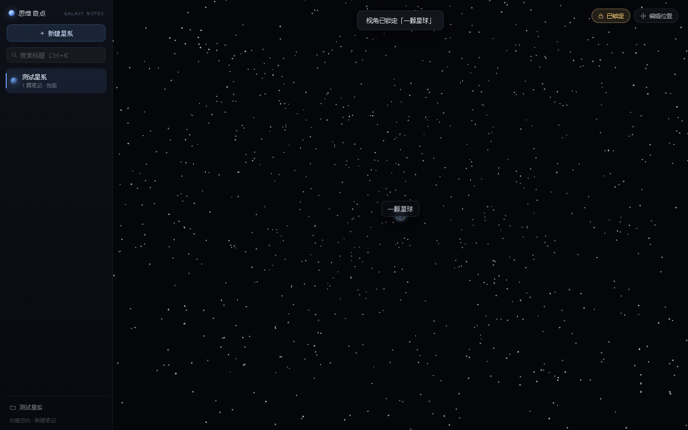

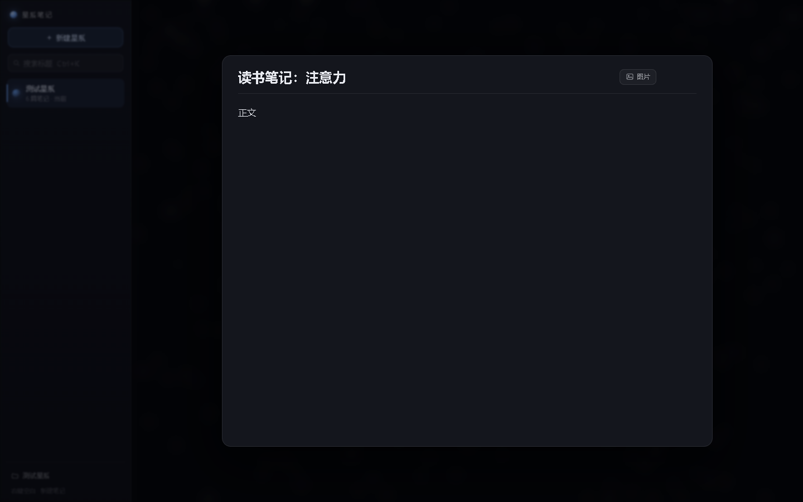

搜索只匹配**当前星系**：标题命中排前面，正文命中会带一段上下文并高亮；大小写不敏感；回车打开第一条，Esc 清空。编辑器里 `Ctrl+K` 留给「插入链接」，不会被搜索抢走。

关联是无向的，所以编辑器底部列的是「跟这篇相连的所有笔记」，不分方向。切过去之前会先把当前这篇存盘。

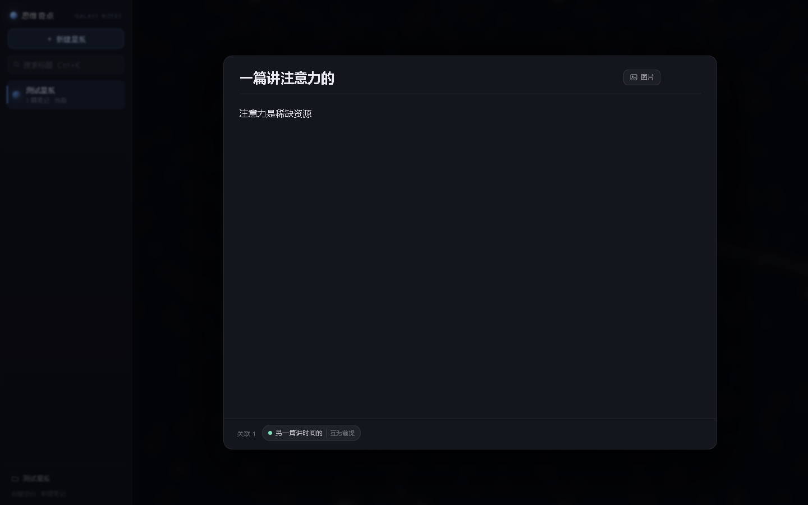

### 星球大小

右键星球 →「星球外观」，除了颜色还有一条大小滑条：

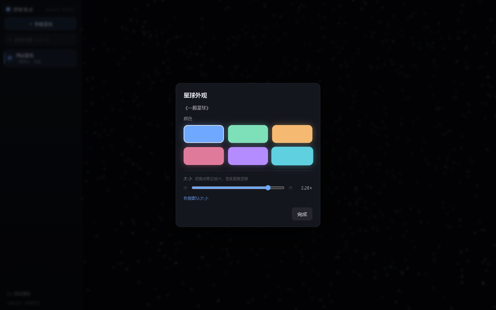

默认 1.00×，范围 0.6×–2.5×，拖动时星球实时变化，松手落盘。它的作用是**手动突出重点笔记**——关联多（度数高）的星球本来就会略大一点，这个滑条是在那之上再叠一层个人意图。`scale` 存在笔记 JSON 里，没有这个字段的旧笔记按 1 处理。

### 拖动星球调整布局

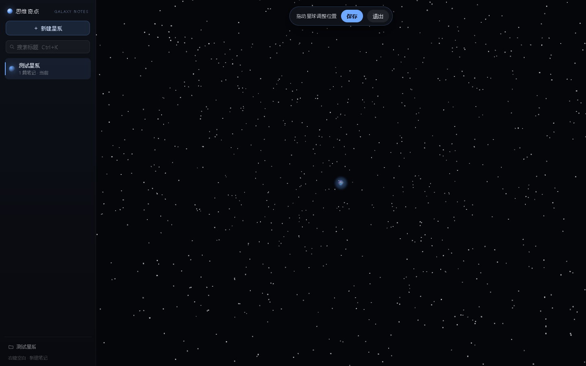

星系是力导向自动排的，但你可能想自己摆一下。点右上角「编辑位置」进入布局编辑：

- 直接拖星球，**沿相机平面移动**（保持原来的景深，不会被拖成扁平）
- 拖动时轨道控制会临时禁用，松手恢复，不会边拖边转视角
- 顶部工具条：**保存**（写盘，可以继续拖）/ **退出**
- 退出时如果动过，弹确认框：
  - 「保存并退出」→ 只把移动过的星球写回 JSON，其余不动
  - 「不保存，恢复原样」→ 所有星球回到进入编辑前的位置
- 编辑模式下不会误触：点星球不进编辑器、右键菜单不弹、Ctrl 多选失效；`Esc` 等同点退出

### 锁定视角

星球多了以后，想盯着一颗看会很别扭。中键点它：

- **只平移视线中心，保持你当前的观察距离和角度**（不是「飞过去」，所以不会突然拉近）
- 锁定后：左键拖动 = 绕着这颗球转，滚轮 = 围着它缩放
- 星球外圈亮起，右上角按钮变成金色「已锁定」
- 解锁：再中键点一次同一颗，或者点那个按钮
- 中键点另一颗 = 直接切过去；切换星系时自动解锁

### 待办书签

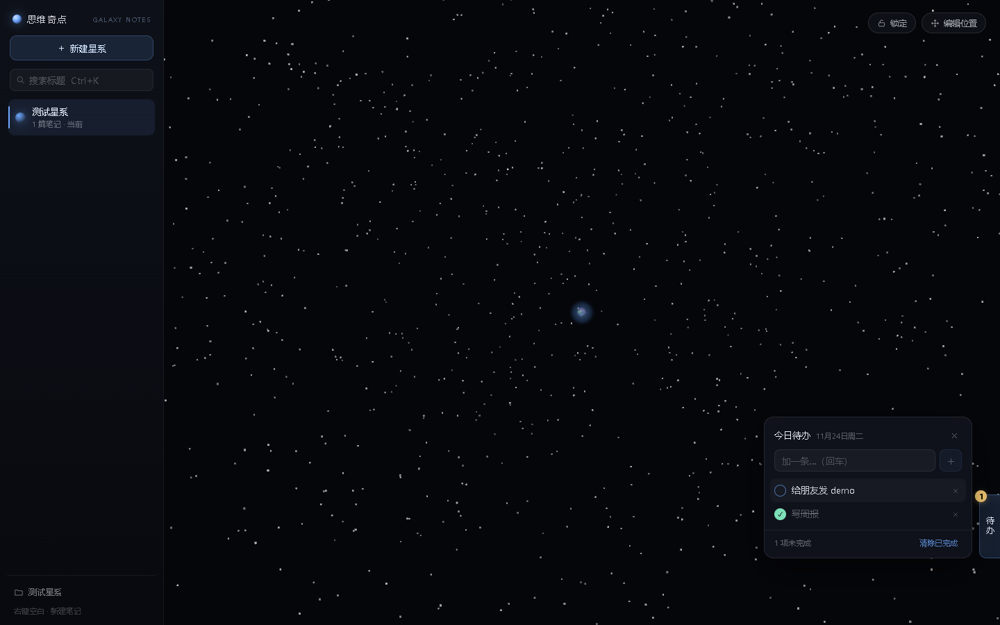

屏幕右下角贴着一张竖排的「待办」书签，点开就是一个今日清单：

- 输入框回车就加一条（`+` 按钮也行）
- 点左边的圆圈打勾，那条变成划线灰字
- 每条右侧有 `×` 删除（悬停才显形，不打扰）
- 底部显示还有几项没做完，有已完成的会出现「清除已完成」
- 未完成数量会显示成书签左上角的黄色小徽章
- `Esc` 或点 `×` 收起

数据存在 `%APPDATA%\galaxy-notes\todos.json`，**和笔记库分开**——换星系、换库都不影响今天的清单。跨天不会自动清空（免得把没做完的事弄丢），要清就手动删或「清除已完成」。

### 新建星系的路径护栏

选目录时会先过一道检查，下面这些**直接拒绝**并说明原因：

| 拒绝 | 原因 |
|---|---|
| 磁盘根（`C:\`） | 整个盘当库太危险 |
| 用户主目录（`C:\Users\你`） | 同上 |
| 桌面 / 文档 / 下载 / 图片 / 音乐 / 视频 / OneDrive | 系统一级文件夹，里面通常还有大量别的文件 |
| `AppData`、`Windows`、`Program Files`、`ProgramData` | 应用/系统目录 |

**放桌面是允许的，但必须是桌面下的一个子文件夹**（比如 `Desktop\星系笔记`）；主目录下你自己建的文件夹（`C:\Users\你\GalaxyNotes`）也允许。这样「删星系」时最多只会碰到这个子文件夹。

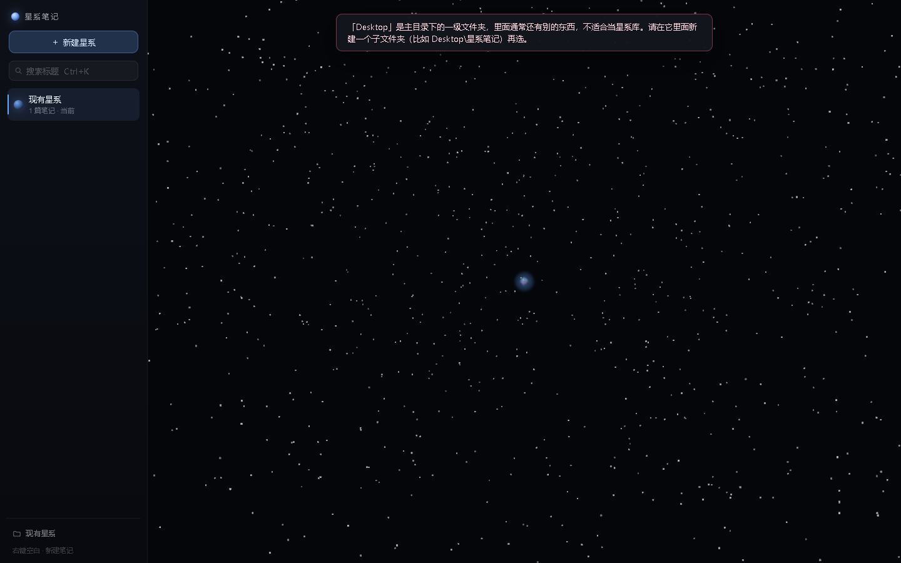

### 删除星系

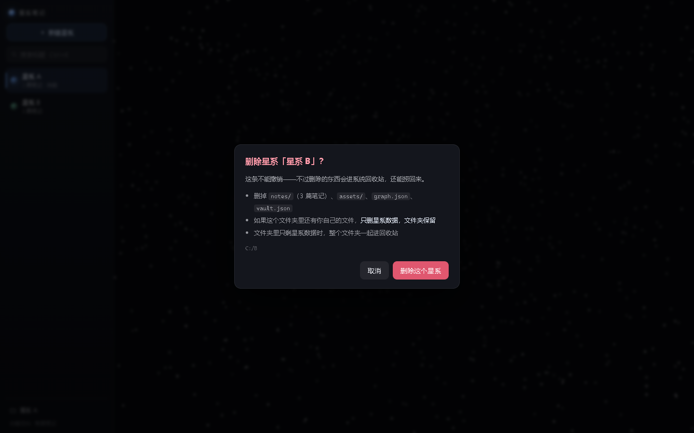

`×` 是**真删**，点之前会弹一次确认。删的规则按「不误伤用户文件」定：

- 只删这个星系的 `notes/`、`assets/`、`graph.json`、`vault.json`，全部走 `shell.trashItem`（**进系统回收站，能捞回来**）
- 文件夹里如果还有你自己的文件（比如 `Pictures` 里的照片），**只删星系数据，文件夹保留**
- 只有文件夹里仅剩星系数据时，整个文件夹才一起进回收站
- 删的是当前星系 → 自动切到列表里的下一个；一个都不剩就回欢迎页

切换前会先把编辑器里的内容落盘，不会丢字。星系清单存在 `%APPDATA%\galaxy-notes\vaults.json`，第一次跑多库版本时会自动把旧的 `last-vault.json` 迁移成第一项。

### 星系里

| 操作 | 结果 |
|---|---|
| 右键空白 | 新建笔记 / 粘贴为新笔记 |
| 左键点星球 | 进入编辑（星系留在背景模糊变暗） |
| 点卡片外空白 / Esc | 保存并缩回星球 |
| Ctrl + 左键星球 | 选中，最多 2 个（满了替换最早选中的） |
| 选中 2 个后右键 | 建立关联…（弹模态，标签可留空） |
| 右键单颗星球 | 打开 / 重命名 / 改颜色 / 复制 ID / 删除… |
| 拖拽空白 | 旋转视角；滚轮推拉镜头 |
| 悬停星球 150ms | 浮出标题 |
| 悬停连线 | 提亮并显示关联标签 |
| Ctrl+S | 立即保存 |
| Ctrl+V / 拖入图片 | 存进 `assets/<gid>/` 并插入正文 |
| 编辑器右上角「图片」 | 选本地图片插入（同样的存法） |

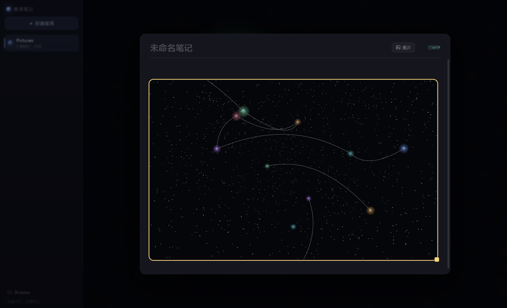

图片落盘到 `assets/<gid>/`，正文里存相对路径、渲染时走自定义协议 `asset://local/...`；右下角手柄可以拖宽度，宽度写进节点的 `width` 属性。单张上限 20MB，支持 png/jpg/jpeg/gif/webp。

编辑器只支持规格 §8.1 的格式：标题 1/2/3、加粗、斜体、删除线、行内代码、固定黄色高亮、有序/无序/任务列表、引用、分隔线、图片（可拖右下角改宽度）、链接。

## 3. 目录

```
galaxy-notes/
├── electron/
│   ├── main.ts             # 窗口、asset:// 协议、生命周期、关窗 flush
│   ├── preload.ts          # contextBridge 暴露 window.api
│   ├── selftest.ts         # 数据层自测（33 项断言）
│   └── ipc/
│       ├── store.ts        # 库文件系统层（不依赖 electron，可单测）
│       ├── vault.ts notes.ts links.ts assets.ts menu.ts
│       ├── context.ts      # 当前库 / 主窗口
│       └── pointer.ts      # 记住上次打开的库
├── shared/                 # 主进程与渲染进程共享的类型、常量
├── src/
│   ├── App.tsx             # 状态机外壳 + 右键菜单编排
│   ├── store/              # zustand：vaultStore / uiStore
│   ├── scenes/galaxy/      # GalaxyScene / Planet / PlanetTexture / Links / Starfield
│   ├── scenes/editor/      # EditorOverlay / NoteEditor / ResizableImage
│   └── components/         # 各个模态、Toast、Welcome
└── scripts/                # 自测与无头预览脚本
```

## 4. 已经验证过的

数据层（`node scripts/test-store.mjs`，33 项全绿）：

- 首次初始化建出 4 个文件/目录 + 欢迎笔记
- 笔记 create / read / update 往返，`created` 不被覆盖
- 无向规范化：反向入参落盘后仍是一条 `a < b` 的记录
- 重复建链识别为「已有关联」并更新标签；自环被拒
- 删笔记：文件走 `shell.trashItem`（测试里用注入的 trash 记录调用）、`assets/<gid>/` 删除、相关边级联删除
- `graph.json` 写坏 → 备份成 `graph.json.corrupt-*`、重建空图、笔记不丢
- 孤儿边加载时静默清理并写回
- 原子写入无 `.tmp-` 残留；>20MB 图片与非图片扩展名被拒；设置往返一致

`scripts/intro-test.mjs`（开场动画）：

- 启动后立刻出现 `.intro` 覆盖层，中文「思维奇点」+ 英文「GALAXY NOTES」
- 约 3.9 秒后自动消失（3.4s 动画 + 0.42s 淡出），露出主界面
- 点击或按任意键都能提前跳过
- 采样过时间线：0 / 315 / 732 / 3345 / 3608 / 3871ms 时仍在，4133ms 时已卸载

渲染与交互（`pnpm test:ui`，用系统 Chrome headless + mock 的 `window.api`）：

`scripts/interact-test.mjs`：

- 悬停星球 → 150ms 内出现标题浮层
- 点击星球 → 进入编辑态（`.editor-card` 出现）
- 正文输入 → 800ms 防抖自动保存，`noteUpdate` 收到含新文本的 patch
- Esc → 保存并回到星系
- 右键空白 → 触发 `showContextMenu`
- 全程 0 个 console error / pageerror

`scripts/link-test.mjs`：

- Ctrl+左键连点两颗 → 底部出现「已选中 2 颗星球」提示
- 右键 → 菜单项里含 `make-link`（且仍保留打开/重命名/改色/复制 ID/删除）
- 关联模态打开 → 输入标签 → `linkCreate({ a, b, label })` 被调用，连线出现（截图 `docs/screenshots/linked.png`）
- 右键空白 → 「新建笔记」→ 直接进编辑态，`noteCreate` 的 pos 是鼠标射线在 z=0 平面上的落点（实测 `[71.8, -54.3, 0]`，在星系半径 90 以内）

`scripts/wheel-test.mjs`：滚轮 5 档后截图对比，画面确实推近（星球像素尺寸变大）。

`scripts/sidebar-test.mjs`（多星系）：- 侧边栏渲染出 2 个星系，当前那个带高亮与左蓝条
- 点另一个星系 → 调 `vaultSwitch` → 重新加载 → 高亮与「N 篇笔记」都跟着变（3 → 5）
- 点「+ 新建星系」→ 调 `vaultCreate`

`scripts/search-test.mjs`（搜索）：

- 输入「读书笔记」→ 只列出 2 篇标题匹配的笔记，命中片段被 `<mark>` 高亮
- 搜「十月」→ 标题里没有，但正文里有：命中 1 篇，结果带一段上下文，`<mark>` 落在正文片段上
- 搜索时星系列表被结果列表替换
- 点结果 → 进编辑器，标题对得上；输入不存在的词 → 0 条 + 空提示；Esc 清空后列表恢复

`scripts/related-test.mjs`（反向链接）：

- 打开有 1 条关联的笔记 → 底部出现「关联 1」+ 对方标题 + 标签
- 点这个 chip → 先 `noteUpdate` 落盘，再切到另一篇（标题对得上）
- 打开没有关联的笔记 → 显示空提示

`scripts/scale-test.mjs`（星球大小）：

- 右键星球 → 弹「星球外观」，6 个颜色 + 1 条大小滑条
- 拖到 2.2× → 显示 `2.20×`，调用 `noteUpdate({ scale: 2.2 })`
- 「恢复默认大小」→ 回到 1

`scripts/layout-test.mjs`（拖动星球）：

- 点「编辑位置」→ 顶部出现「拖动星球调整位置」工具条
- 编辑模式下点星球**不会**打开编辑器
- 拖动后点「退出」→ 弹「保存位置改动？」
- 「保存并退出」→ `noteUpdate` 带新 `pos`（实测 `[20.8, -9.7, 3.2]`），工具条消失
- 再拖一次选「不保存，恢复原样」→ 没有新的写盘，退出

`scripts/lock-test.mjs`（锁定视角）：

- 右上角有「锁定」按钮，未锁定时是灰的
- 中键点星球 → 按钮变金色「已锁定」
- 再中键点同一颗 → 解锁
- 重新锁定后点按钮 → 回到自由视角

`scripts/delete-vault-test.mjs`（删除星系）：

- 悬停列表项出现 `×`；点它弹的是确认框（标题「删除星系「…」？」），不是直接删
- 点「取消」→ 列表不变、没调用 `vaultDelete`
- 点「删除这个星系」→ 调 `vaultDelete`，列表少一项

`scripts/guard-test.mjs`（路径护栏，渲染层）：

- 新建星系被主进程拦下时，侧边栏弹**红色 toast** 说明原因（不是静默失败）
- 星系列表保持不变

`scripts/cdp-guard-test.mjs`（路径护栏，**真实 Electron**）：直接调 `vaultCheckPath` 跑 12 个路径，实测：

```
拒绝：C:\、C:\Users\19403、Desktop、Pictures、Downloads、Documents、AppData、Windows
允许：Desktop\美学积累、C:\Users\19403\GalaxyNotes、Documents\笔记、D:\Notes
```

`scripts/cdp-delete-vault.mjs`（删除星系，**真实 Electron**）：

建一个带用户文件的临时库 → `vaultDelete` → 检查磁盘。实测：

```
scope: partial          # 目录里有 README-keep.txt，所以只删星系数据
remaining: ["美学积累"]  # registry 里已移除，自动切到下一个
tmpDirExistsAfter: true  # 文件夹保留
leftovers: ["README-keep.txt"]  # 用户文件没动
vaultJsonLeft: false     # 星系数据清空
```

> 这一步也抓到一个真 bug：IPC 传进来的路径可能是 `C:/...`（正斜杠），而 registry 里存的是 `path.resolve()` 后的 `C:\...`，字符串比对失败会报 `VAULT_NOT_FOUND`。现在所有 vault 相关 handler 入口统一 `path.resolve()`。

`scripts/image-test.mjs`（图片，headless Chrome）：

- 编辑器右上角有「图片」按钮，点了会调 `pickImage` 并插入节点
- 插入的 `src` 必须是 `asset://local/assets/<gid>/...`，不能是本地绝对路径
- 粘贴事件带图片 → 调 `assetSave` → 追加到文中（不会替换已有图片）

`scripts/cdp-image-test.mjs`（图片，**真实 Electron**）：

先用 `Galaxy Notes.exe --remote-debugging-port=9222` 启动，再跑这个脚本。它通过 CDP 连上真实窗口，进编辑器、派发一次带图的 paste，然后检查 `` 的 `naturalWidth`：

- 实测 `naturalWidth=1440 / naturalHeight=900 / renderedWidth=813` —— 说明 `asset://` 真的把文件读出来并渲染了

> 这个检查抓出过一个真 bug：`asset://` 的 handler 把 `relPath`（本身已带 `assets/`）又拼了一次 `root/assets`，变成 `assets/assets/...`，表现就是「图片插进去了但显示不出来」。现在改成相对库根解析 + 前缀校验防目录穿越。

打包：`electron-builder --win --dir` 已成功产出 `release/win-unpacked/Galaxy Notes.exe`（app.asar 2.9MB）。NSIS 安装包没有在本机产出，原因见第 6 节。

## 5. 这一版没做 / 简化了的地方（照实列）

**没做**

- **M5 的 AI 关联**：没有设置页、没有 `safeStorage`、没有任何网络请求。菜单里不出现 AI 项（规格要求 M5 之前不出现）。
- 反向链接面板、搜索、标签、时间轴等 P1 功能。
- 设置页 / 手动导入导出。
- 安装包已验证到 `--dir` 级别；NSIS 安装包的产出见第 6 节实际结果。

**做了但和规格字面不同（都是有意为之）**

1. **星球纹理补了一步圆形 alpha 遮罩**。规格 §7.3 的绘制流程是「底色 → 斑块 → 明暗 → 外圈辉光」，最后一张纹理仍是满幅不透明方图，贴到 Sprite 上在黑底里就是**带光晕的彩色方块**。第 5 步用 `destination-in` 把四角擦透明。确定性不受影响（seed 仍只来自 gid）。
2. **星球视觉尺寸 ×2.2**（`Planet.tsx` 的 `PLANET_VISUAL`）。§7.4 的半径公式照抄（保留「枢纽笔记更大」的相对关系），但按公式在默认镜头距离下球只有十来个像素，既看不清纹理也认不出是星球。只放大 Sprite 显示尺寸，不改数据。
3. **编辑态背景是 `blur(10px) brightness(0.5)`**，不是 §5.3 的 `blur(8px) brightness(0.35)`。0.35 下星系几乎全黑，用户感受不到「星球还在背后」，空间连续感就丢了。星系 canvas 始终挂载，切回来不会重建黑屏。
4. **右键菜单的拦截放在渲染进程**（星系容器 `onContextMenu` 里 `preventDefault`），不是主进程 `webContents.on('context-menu')` 全局拦截。全局拦截会把编辑器里的复制/粘贴右键菜单也一起干掉。
5. **力导向布局只排「还没有位置」的节点**，已有 `pos` 的节点被 `fx/fy/fz` 固定。规格写的是启动时全量跑 300 tick 再写回，那样每次启动坐标都会轻微漂移，A4「重启后星球位置不变」不成立。新节点仍然用 Fibonacci 球面播种 + 300 tick 收敛。
6. **`linkCreate` 返回 `{ link, existed }`**（规格 §4 只返回 `Link`）。需要区分「新建」和「已有关联、只更新了标签」，才能在 UI 上给不同 Toast。
7. 连线的标签用 canvas 文字 Sprite 实现（悬停时淡入），不是 DOM 浮层。星球标题浮层是 DOM（`<Html>`），`pointer-events: none`，不吃鼠标事件。
8. 编辑态星球尺寸动画用 `THREE.MathUtils.damp` 指数收敛，不是规格里「150ms 过渡」的定时补间——观感一致，代码更少。
9. 关窗保存：主进程发 `app:flush`，渲染进程 flush 后回 `app:flushed`，1.6s 兜底强关。

**还没验证到的**

- 真实 Electron 窗口里的观感（见第 7 节：当前沙箱里 Electron GUI 起不来）。
- 右键原生菜单的点击顺序（`Menu.popup` 的 `click` 与 `callback` 竞争，代码里用 settled 标志 + 30ms 兜底，但没有在真窗口里点过）。
- 中文输入法 composition 期间点击画布不退出（代码路径已实现 `composing` 标志 + `compositionend` 后 100ms 释放，但没有真实 IME 可测）。
- A9 性能（500 篇 / 1500 边 / 50fps）没有造数据实测。
- 图片粘贴 / 拖入 / 缩放拖拽的实现没有真实剪贴板可测。

## 6. 打包

```powershell
pnpm pack     # 构建 + 出 release/win-unpacked（已验证可用）
pnpm dist     # 再打 NSIS 安装包
```

产物在 `release/`。electron-builder 需要下载 winCodeSign / NSIS 资源，国内可设置：

```powershell
$env:ELECTRON_BUILDER_BINARIES_MIRROR = "https://npmmirror.com/mirrors/electron-builder-binaries/"
```

本机实际结果与两个坑：

1. **github.com 不可达**，electron-builder 默认要从 GitHub 下 electron zip。用 `--config.electronDist=node_modules/electron/dist` 直接复用已装好的二进制解决。
2. **winCodeSign 解压失败**：7z 里 macOS 的 `.dylib` 是符号链接，普通权限账户建不了，报 `Cannot create symbolic link`。`--config.win.signAndEditExecutable=false` 跳过 rcedit/签名之后打包通过（代价是 exe 没有自定义图标和版本信息）。
3. NSIS 安装包没有继续尝试：当前沙箱里 Electron GUI 起不来（见第 7 节），装了也验证不了能不能启动，不如把这一项留给能跑 GUI 的机器。

### 6.1 这台机器必须装到 `%LOCALAPPDATA%`（踩过的坑）

打好的 `release\win-unpacked` **不能原地运行**：它在 `Documents\...` 下启动时，Electron 进程会在初始化阶段直接崩掉（事件日志里是 `0xc0000005`，探针只跑到 `main start` 就没了）。同一个 Electron 二进制复制到 `%LOCALAPPDATA%` 下立刻正常（`app ready → window created → did-finish-load`）。这台机器的 `Documents` 目录上有安全软件在拦 Chromium。

所以运行副本统一放在 `%LOCALAPPDATA%\GalaxyNotesApp`：

- 首次安装 / 每次重新打包后：双击 **`安装并启动.cmd`**（robocopy 同步过去再启动）
- 之后启动：桌面快捷方式，或 `启动.cmd`
- 排错：`启动-带日志.cmd`，日志在 `%LOCALAPPDATA%\GalaxyNotesApp\run.log`

顺带排除的几种猜测：不是 Electron 版本（33 / 44 / 45 在 Documents 下都崩）、不是 `--no-sandbox` 缺失、不是 userData 目录权限（ACL 正常）、不是 Smart App Control / HVCI（都没开）。

## 7. 截图是怎么来的

`docs/screenshots/` 里的图由 `scripts/preview-renderer.mjs`、`scripts/interact-test.mjs`、`scripts/link-test.mjs`、`scripts/welcome-shot.mjs` 生成：起一个静态服务器伺服 `out/renderer`，注入一份 mock 的 `window.api`（12 篇笔记 + 8 条关联），用系统 Chrome（headless + SwiftShader）真实渲染 WebGL 后截图。

用 Chrome 而不是 Electron 是因为**当前沙箱里 Electron 的 GUI 进程启动即崩**（连 `electron.exe --version` 都是 `STATUS_BREAKPOINT` / `0x80000003`），只有 `ELECTRON_RUN_AS_NODE` 模式能跑。渲染层代码本身不依赖 Electron API（全部走 `window.api`），所以这个预览能验证 three / R3F / TipTap 是否正常，但**不能替代真窗口验收**。

在正常机器上验证：

```powershell
Remove-Item Env:ELECTRON_RUN_AS_NODE
pnpm pack      # 构建 + 出 unpacked 目录
.\release\win-unpacked\"Galaxy Notes.exe"
```

## 8. 数据格式速查

```ts
// notes/<gid>.json
interface Note {
  gid: string          // 10 位，创建后不变
  title: string
  created: string      // ISO 8601 带时区
  updated: string
  color: string        // #6ea8ff
  pos: [number, number, number]
  doc: ProseMirrorDoc  // TipTap getJSON() 原样存
  text: string         // 纯文本快照（≤20000 字符），给将来的搜索 / AI 用
}

// graph.json —— 字段是 a / b，不是 from / to
interface Link {
  id: string           // l_ + 8 位
  a: string            // 恒为字典序较小者
  b: string            // 恒为字典序较大者
  label: string
  origin: 'manual' | 'ai'
  created: string
  aiRationale: string | null
}
```

写入前强制执行 `if (a > b) [a, b] = [b, a]`，所以 `(A,B)` 和 `(B,A)` 永远是同一条记录。
